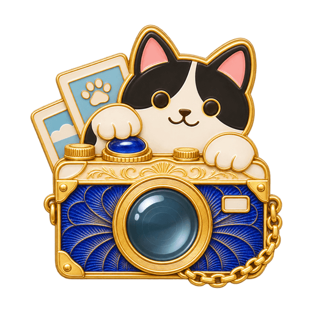
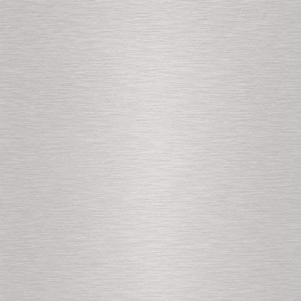

# Enamel Cat Badges · 珐琅猫咪徽章

以猫咪与主题的自然互动设计收藏徽章，把节气、节日、日常行为和纪念主题整理成可复用的策划、生图与交付流程。

仓库包含一个可独立安装的 **Codex skill**、25 张五档正面参考与 1 张冰蓝金边配色，以及素钢、铜、银、金、典藏五张背面材质。款式数量、等级结构、材质和细节方向分别选择，支持单枚、平行多款与分级系列。

## 作品预览

下面展示当前五档中的典藏参考。新主题可沿用猫咪造型与珐琅质感，重新设计动作、装饰物、构图和工艺精度。

| 猫口普查 | 吸猫 | 留影 |
| :---: | :---: | :---: |
|  |  |  |

| 便利贴 | 点赞 |
| :---: | :---: |
|  |  |

### 五档示例

猫口普查由基础的猫与放大镜，逐步加入地图、草丛和调查装备。典藏增加釉下刻纹与弧面定位石。

| 素钢 | 铜 | 银 | 金 | 典藏 |
| :---: | :---: | :---: | :---: | :---: |
|  |  |  |  |  |

新增[留影典藏·冰蓝金边](sample/fronts/05_留影_典藏_冰蓝金边_正面.png)配色，保留原深蓝典藏款。


全部正面统一1254×1254透明RGBA，主体最长边1054px、包围盒居中；各枚长宽比保持原样。

## 安装

将仓库链接发给 Codex，让它安装这个 skill：

> 请帮我安装这个仓库中的 enamel-cat-badges skill：https://github.com/xuannfx/enamel-cat-badges

安装完成后，在会话中用 `$enamel-cat-badges` 调用。实际生成使用会话中可用的图像工具。

## 开始使用

可以先描述一个主题，让助手补齐需求：

> 使用 $enamel-cat-badges，帮我设计一枚中秋猫咪徽章，先聊设计方向。

也可以直接给出完整选择：

> 使用 $enamel-cat-badges，做一枚银色金属加彩色珐琅的中秋徽章，无等级。希望装饰物丰富，有桂枝、弯月和月饼，表面纹饰克制。先给策划和完整提示词。

> 使用 $enamel-cat-badges，设计立春主题的三级徽章，全部用银色金属，按配饰和环境递进。以大尺寸收藏展示为目标，内部掐丝纤细。先给三款方案。

开始设计前，skill 会确认以下内容。已明确的信息直接采用，缺失项集中询问；也可以指定哪些部分由助手策划。

| 选择 | 要确定的内容 |
| --- | --- |
| 主题 | 具体节气、节日、行为或纪念主题 |
| 材质与工艺 | 金属外观、表面处理、珐琅或其他材料，以及作用部位 |
| 款式与等级 | 单枚、平行多款或分级系列；分级时确定级数 |
| 细节方向 | 装饰物丰富程度、构图层次、表面纹饰与工艺精度 |

## 设计方法

### 猫与主题自然互动

先设计猫正在做什么，再安排道具和环境。猫的视线、前爪、后肢、尾巴与接触点共同建立动作，例如探看新芽、轻扶桂枝、按下快门或拨动铅笔。

珐琅风格以金属胎、彩色釉面和浅浮雕表现形体，外轮廓随猫与主题元素形成紧凑实体。现有素材提供基础语言，新主题的细节密度与展示尺度按本次需求确定。

### 分别设计四项细节

| 维度 | 具体设计内容 |
| --- | --- |
| 装饰物与情境 | 物件的种类、数量、形态和作用 |
| 构图层次 | 猫与物件的大小、位置、遮挡及整体轮廓 |
| 表面纹饰 | 花纹所在部位、覆盖范围与疏密 |
| 工艺精度 | 隔线比例、釉色分区、浮雕及表面处理 |

情境丰富的版本可以包含更多物件，少物件的版本也可以采用精细工艺。大尺寸方案分别控制外缘、主分区线和局部细掐丝的粗细与起伏。小尺寸基础款另做 32／40／48px 检查。

### 独立设计不同版本

改变方向时，先重新安排物件与空间关系，再写出该版完整提示词。每版说明所需参考及借鉴范围；生成入口支持独立请求时，只传入该版需要的图片与说明。入口的历史隔离能力会随实际工具一并说明。

[中秋版本对照](enamel-cat-badges/references/versions.md)提供“情境丰富、纹饰克制”和“少物件、高精工”两份完整提示词，可用于比较不同设计方向。

## 从正面到背面

1. **确认需求**：确定主题、材质、款式与细节方向。
2. **策划与生图**：形成角色、动作、构图及完整提示词，生成正面方案。
3. **确认正面**：评审结构、互动、材质与细节，按反馈调整。
4. **确认背面材质**：正面获认可后，告知匹配的颜色、表面处理、纹理尺度、数量及生成／复用方案。
5. **制作与交付**：背面方案确认后生成或采用材质图，整理透明正面、材质和文件映射。

### 可复用的背面材质

现有五张满幅金属材质中，金银铜为512×512，素钢为1254×1254，典藏锤目金源文件为1024×1024。按档位匹配表面，使用正面水平镜像后的 Alpha 蒙版裁出背面轮廓。

| 暖浅金 | 浅银 | 桃铜 |
| :---: | :---: | :---: |
|  |  |  |

素钢使用[枪灰色细拉丝材质](sample/materials/metal-steel.png)，典藏使用[疏浅锤目金](sample/materials/metal-gold-hammered.png)。压缩正面为512×512；压缩材质统一为512×512。其他材质按确认的方案匹配。交付数量按实际计算：**N 张正面＋M 张独立材质图**，同材质可共享一份。

## 仓库结构

```text
enamel-cat-badges/
├── enamel-cat-badges/        # 可独立安装的 skill
│   ├── SKILL.md             # 入口与需求确认流程
│   ├── agents/              # 显示名称与调用提示
│   ├── assets/              # 策划单、内置参考与素材校验清单
│   └── references/          # 设计体系、提示词、版本流程及素材索引
├── sample/
│   ├── fronts/              # 26 张1254×1254透明正面
│   └── materials/           # 5 张原版金属材质
├── sampled_compressed/      # 压缩版素材，与 sample 目录结构一致
│   ├── fronts/              # 26 张压缩版透明正面
│   └── materials/           # 5 张压缩版金属材质
└── README.md
```

## 参考文档

- [设计体系](enamel-cat-badges/references/design-system.md)：角色、工艺、细节维度、尺度与交付规则。
- [提示词示例](enamel-cat-badges/references/prompts.md)：立春、端午和中秋方案。
- [版本设计与生成](enamel-cat-badges/references/versions.md)：版本差异、参考图使用及上下文处理。
- [系列策划单](enamel-cat-badges/assets/series-brief.md)：记录每套需求、构图与确认结果。
- [素材索引](enamel-cat-badges/references/materials.md)：25 张五档正面、1 张冰蓝金边配色与五张可选金属材质。
