<div align="center">

# Enamel Cat Badges

**珐琅猫咪徽章 · 设计与生成 skill**

[](LICENSE)

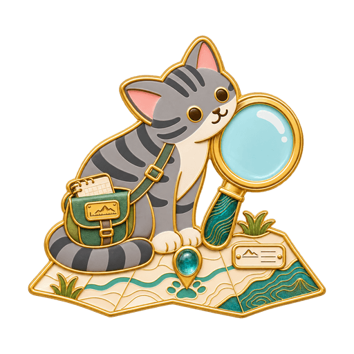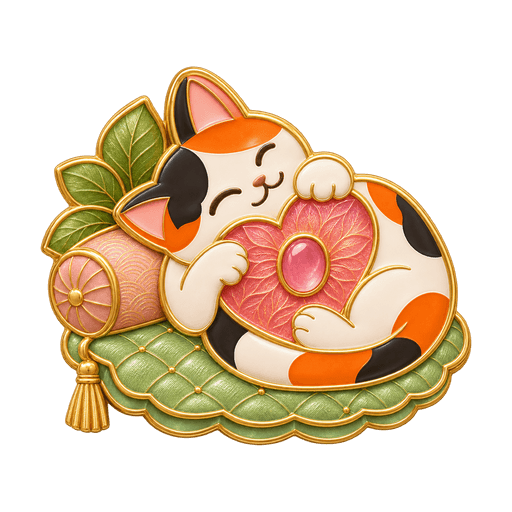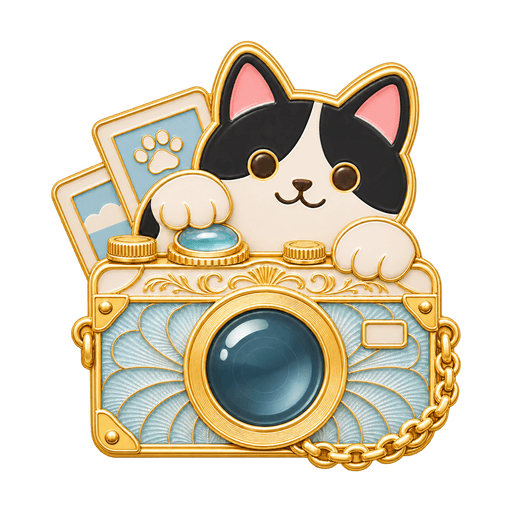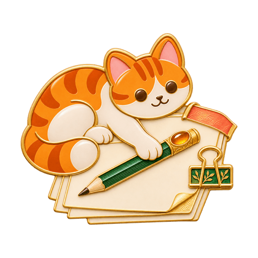

</div>

说一个主题，得到一枚猫咪珐琅徽章。

这个 skill 让 AI 助手按一套固定的设计方法工作：先确定猫在做什么，再安排道具、构图和工艺，写出完整生图提示词，生成正面，最后导出尺寸统一的透明 PNG 并配好背面金属材质。成就系统、节气节日、纪念活动都可以用。

## 作品

从左到右依次为素钢、铜、银、金、典藏。

**猫口普查** · 灰虎斑猫透过放大镜观察

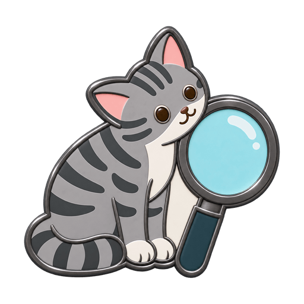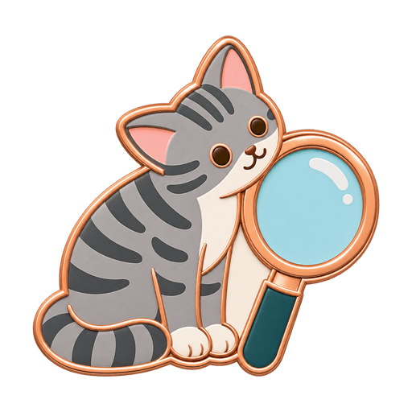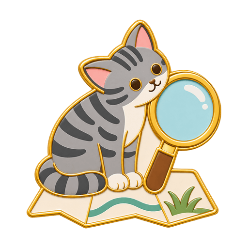

**吸猫** · 三花猫侧躺抱着爱心

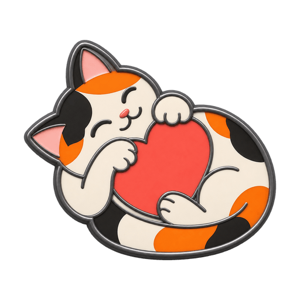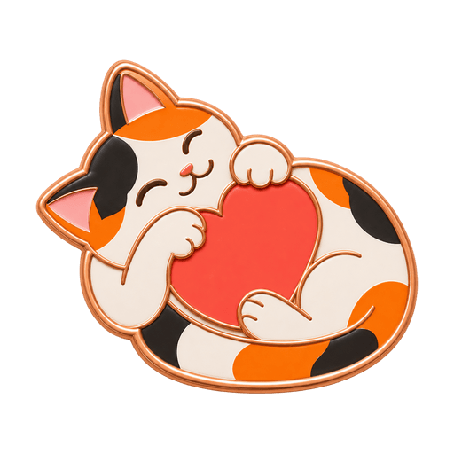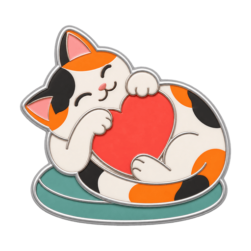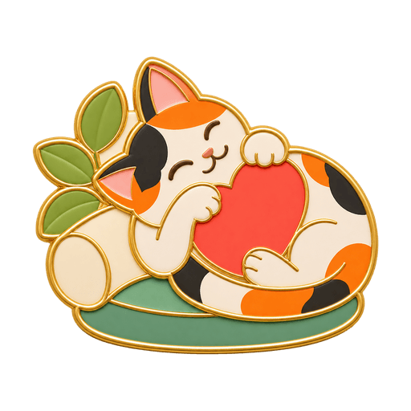

**留影** · 奶牛猫趴在相机后按下快门

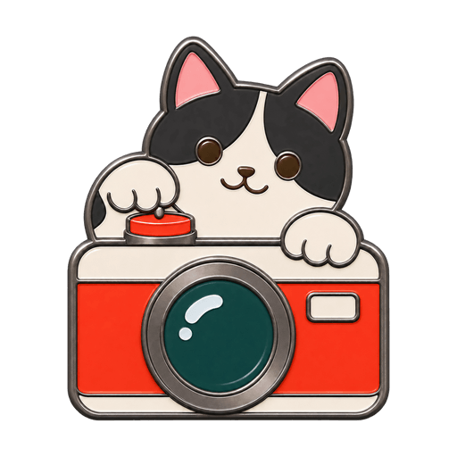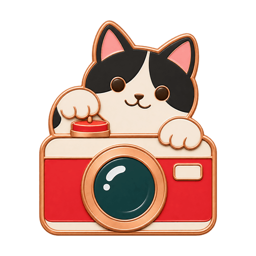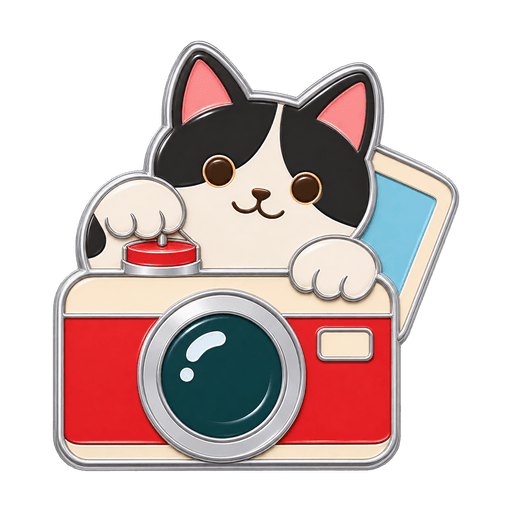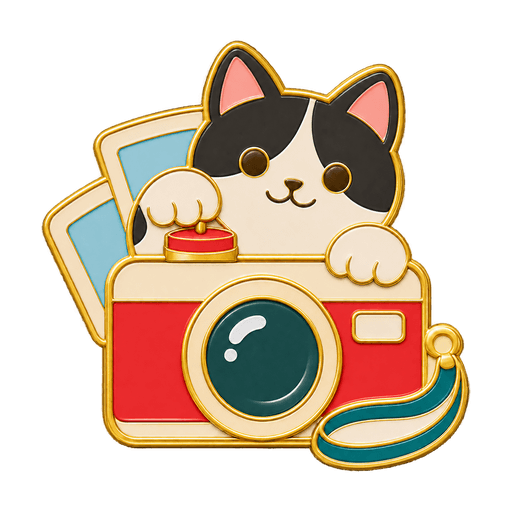

**便利贴** · 橘白猫伏在便签旁拨动铅笔

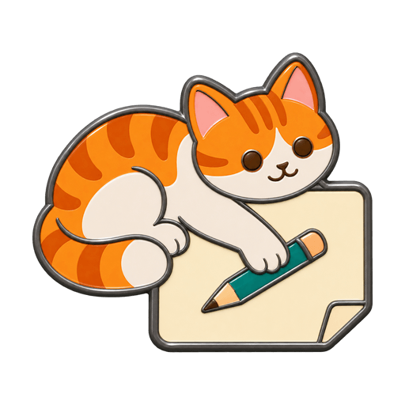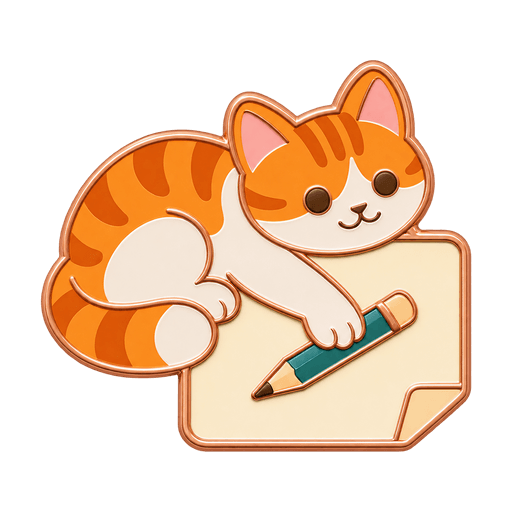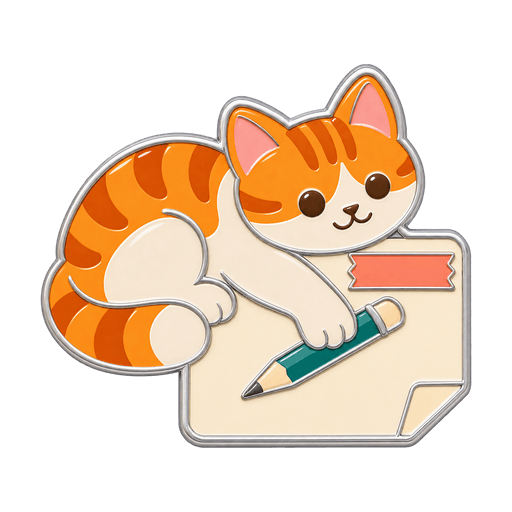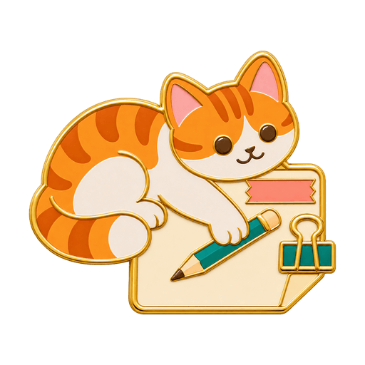

**点赞** · 白猫抬爪碰触人类的拇指

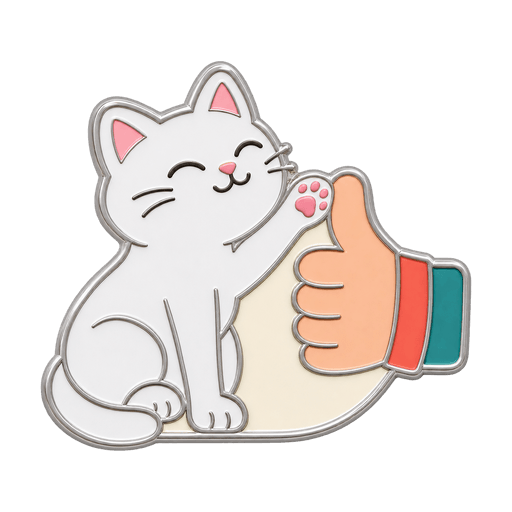

## 安装

把这句话发给 Codex：

> 请帮我安装这个仓库中的 enamel-cat-badges skill：https://github.com/xuannfx/enamel-cat-badges

之后在会话里用 `$enamel-cat-badges` 调用。

## 用法

> 使用 $enamel-cat-badges，帮我设计一枚中秋猫咪徽章，先聊设计方向。

> 使用 $enamel-cat-badges，做一枚银色金属加彩色珐琅的中秋徽章，无等级。装饰物丰富，有桂枝、弯月和月饼，表面纹饰克制。先给策划和完整提示词。

> 使用 $enamel-cat-badges，设计立春主题的三级徽章，全部用银色金属，按配饰和环境递进。大尺寸收藏展示，内部掐丝纤细。先给三款方案。

助手会先确认四件事，缺什么问什么：

- **主题**：哪个节气、节日、行为或纪念日
- **材质**：金属外观、表面处理、是否填珐琅
- **款式**：单枚、平行多款，还是分级系列
- **细节**：装饰物多少、工艺多精细

## 流程

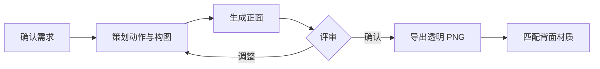

**动作先于道具。** 每枚徽章从猫的一个具体动作出发：按快门、碰拇指、拨铅笔。视线、前爪、后肢和尾巴共同构成这个动作，道具和环境围绕它展开。

**细节分四项设计。** 装饰物与情境、构图层次、表面纹饰、工艺精度各自独立。少物件可以高精工，多物件可以低纹饰。

**轮廓随形。** 外形顺着猫和道具生成紧凑的异形实体，不套圆牌或外框。金属隔线分外缘、主分区、细掐丝三级粗细。

**正反分开。** 正面确认后再定背面。背面取正面轮廓水平镜像作蒙版，从金属材质图里裁出。

## 素材

| | 数量 | 规格 |
| --- | --- | --- |
| [正面原图](sample/fronts) | 26 | 1254×1254 透明 PNG，主体最长边 1054px，居中 |
| [正面压缩版](sampled_compressed/fronts) | 26 | 512×512 透明 PNG |
| [背面材质原图](sample/materials) | 5 | 满幅金属纹理 |
| [背面材质压缩版](sampled_compressed/materials) | 5 | 512×512 |

| 素钢 | 铜 | 银 | 金 | 典藏 |
| :---: | :---: | :---: | :---: | :---: |
| 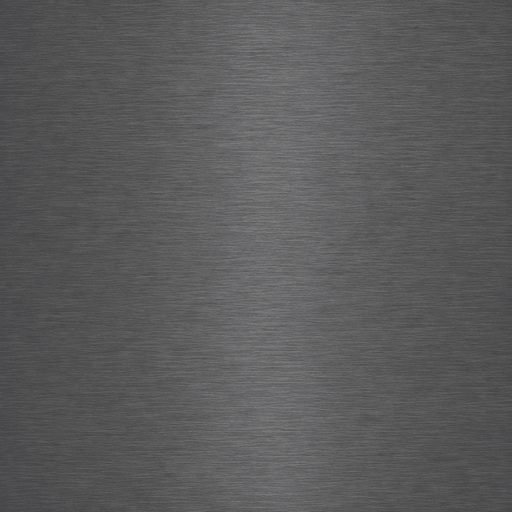 |  |  | 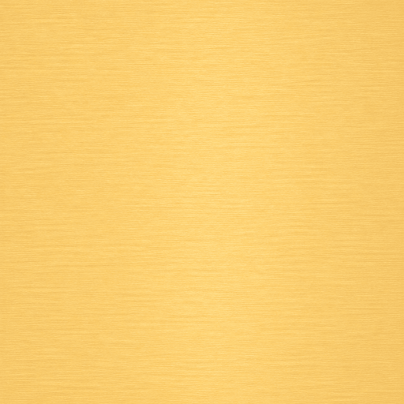 | 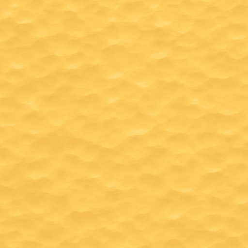 |
| 枪灰拉丝 | 桃铜拉丝 | 浅银拉丝 | 暖金拉丝 | 锤目金 |

## 目录

```text
enamel-cat-badges/        skill 本体
├── SKILL.md              入口
├── agents/               显示名称与调用提示
├── assets/               策划单、参考图、素材清单
└── references/           设计体系、提示词、版本流程、素材索引
sample/                   原图
sampled_compressed/       压缩版
```

## 文档

- [设计体系](enamel-cat-badges/references/design-system.md)
- [提示词示例](enamel-cat-badges/references/prompts.md)
- [版本设计与生成](enamel-cat-badges/references/versions.md)
- [系列策划单](enamel-cat-badges/assets/series-brief.md)
- [素材索引](enamel-cat-badges/references/materials.md)

## 许可

[CC BY-NC 4.0](LICENSE)。非商业使用可自由复制、修改和二次创作，注明来源即可。商业使用请通过 [Issue](https://github.com/xuannfx/enamel-cat-badges/issues) 联系授权。
